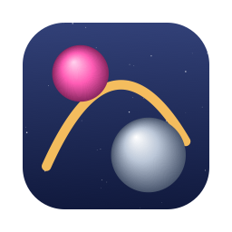
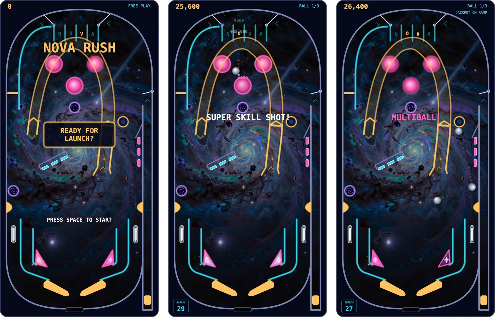
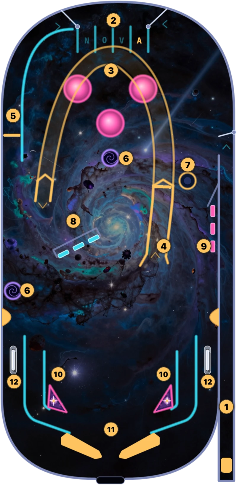
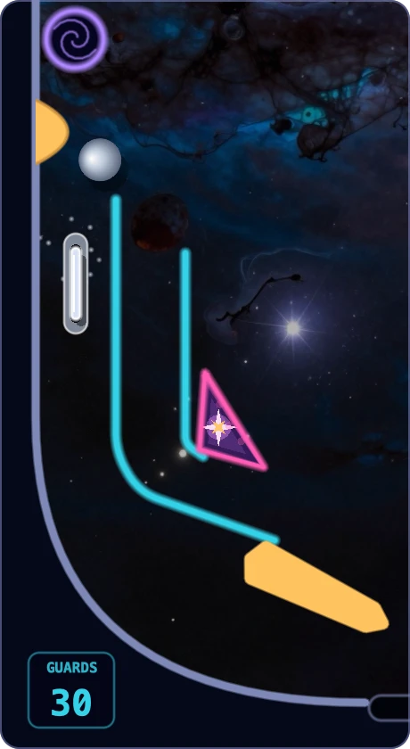
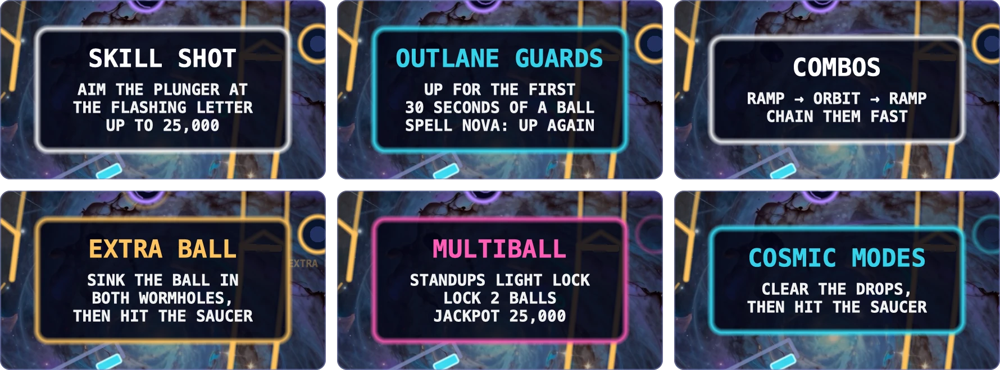

<div align="center">



# Nova Rush

**A space pinball table for your Mac.**<br>
Pop bumpers, a comet ramp, a pair of linked wormholes and three-ball multiball,
with music, voice callouts and an attract show that lights up the table between games.


<a href="../../releases/latest"></a>
&nbsp;
<a href="#how-to-play"></a>

<br><br>



<sub>Waiting for a player &nbsp;·&nbsp; a super skill shot &nbsp;·&nbsp; three-ball multiball</sub>

</div>

## A fun project that became a real table

Nova Rush began purely for fun and for learning: how much of a real pinball
machine can you build from nothing but Swift code? One play-testing session at
a time, the answer grew into a complete table you can actually play — a ball
that rolls, rattles and cradles on the flipper the way it should, a full set of
rules, lamps that react to everything, sound effects, music, a voice that calls
out the big moments, and an attract show that invites you to play.

As tables go, Nova Rush is a simple one: a single playfield with one ramp, one
orbit and three bumpers. The code underneath is built to grow, though, and is a
good starting point for more ambitious tables — see
[Build your own table](#build-your-own-table).

There is no business model, no account and no tracking, and the game never
touches the network. The code is **free to use, modify and redistribute** under
the [MIT license](LICENSE); the music, artwork, voices and generated sound
effects may be shared and adapted for non-commercial purposes (see
[License](#credits-and-license)).

<p align="center"></p>

## The table



Everything on the table is drawn as vectors, so it stays sharp at any window
size; a generated nebula glows underneath.

1. **Plunger lane** — hold Space to pull, let go to launch. The pull aims the
   skill shot.
2. **NOVA lanes** — roll through all four letters to raise the bonus
   multiplier and the outlane guards.
3. **Pop bumpers** — three of them, kicking the ball around the upper field.
4. **Comet ramp** — a firm shot rides it all the way round and drops the ball
   into the left inlane.
5. **Left orbit** — up the left wall, through the spinner, round the top and
   into the lanes.
6. **Wormholes** — a linked pair. A slow ball is swallowed and sometimes comes
   out of the *other* hole.
7. **Nebula saucer** — starts modes, locks balls for multiball and collects the
   Extra Ball.
8. **Drop targets** — clear the bank to light MODE.
9. **Standup targets** — hit all three to light LOCK.
10. **Slingshots** — kick the ball back into play; their lit plastics flash
    with the big moments.
11. **Flippers and inlanes** — a fast ball can ride the bottom arc *around the
    horn* and come back up the other side.
12. **Outlane guards** — steel arches that pop up and kick the ball back to
    the flipper.

<br clear="right">

## How to play

You have **three balls**. Hold <kbd>Space</kbd> to pull the plunger and let go
to launch; a ball that drains within **8 seconds** of the launch comes back for
free. Almost everything you hit adds to the **end-of-ball bonus**, paid out
times the **bonus multiplier** (up to ×8) when the ball drains.

A nudge can save a ball, but shake the table too hard and it **tilts**: the
flippers and kickers go dead, the outlane guards drop and the ball's bonus is
lost.

### Skill shot

When a new ball reaches the plunger, one NOVA letter **flashes orange**. The
pull aims: a little under half for **A**, a bit more for **V**, more for **O**,
a full pull for **N**. If the flashing lane is the first one the ball rolls
through, you score **10,000** for N, or **25,000** for a super skill shot on O,
V or A.

### Outlane guards



In the middle of each outlane, a steel arch rises from a slot in the playfield.
A ball that falls onto it is kicked back up into the inlane, right onto your
flipper. The guards are up for the first **30 seconds** of every ball — the
GUARDS display in the lower left corner counts down, and the arches blink
before they sink. **Spell NOVA** to raise them again for another 30 seconds.
A tilt drops them at once.

### Combos

The ramp and the left orbit are the major shots. Make another major shot
within **5 seconds** to build a combo: ×2 scores **5,000**, ×3 **10,000**, and
so on. While a combo is live, the ramp and orbit arrows blink white.
Ramp → orbit → ramp is the classic route.

### Wormholes and Extra Ball

Each capture scores **2,500**. In 40 % of captures the ball **warps** and comes
out of the other hole, for another 2,500. Get the ball swallowed by **both**
holes during one ball and EXTRA BALL lights at the saucer: collect it there for
a **shoot again**. Up to two per game.

### Multiball

Hit all three standups to light LOCK, then lock a ball in the saucer — twice.
The next saucer shot releases **three balls**, and every ramp is a **25,000
jackpot** while multiball lasts.

### Cosmic modes

Clear the drop targets to light MODE, then hit the saucer for a random
**30-second** mode:

- **Asteroid Storm** — bumpers score 1,000
- **Solar Flare** — spinners 500 per spin, the ramp 5,000
- **Gravity Well** — drop targets 2,500, the saucer 10,000

<br clear="right">

### Scoring

| Shot | Points | |
| :--- | ---: | :--- |
| Slingshot | 10 | |
| Pop bumper | 100 | |
| Spinner | 100 | per spin |
| Standup target | 300 | set of three: 3,000 |
| NOVA lane | 500 | |
| Drop target | 500 | whole bank: 5,000 |
| Comet ramp | 1,000 | |
| Saucer | 1,500 | |
| Wormhole | 2,500 | warp: +2,500 |
| NOVA complete | 5,000 | × bonus multiplier |
| Ball lock | 5,000 | |
| Combo | 5,000 | × (combo − 1) |
| Skill shot | 10,000 | super skill shot: 25,000 |
| Jackpot | 25,000 | during multiball |

**Continuous play** (<kbd>C</kbd>) is for practice: no ball limit and no
scoring, so it never touches the high scores. The full manual, with the same
map, is in the game under **Help** (<kbd>⌘</kbd> <kbd>?</kbd>).

## The attract show

Like a real machine, Nova Rush doesn't just sit there while it waits for a
player. Between games it runs an attract show: rule teasers pop up on a display
in the middle of the table and light up the parts they talk about — the
flashing skill-shot letter, the outlane arches, the saucer — in turn with the
high scores, the score of the last game and a lamp show. Now and then a voice
invites you to play. The flipper buttons page through the show, and
<kbd>Space</kbd> starts a game.

<p align="center">
  
</p>

<p align="center"></p>

## Controls

| Key | Action |
| :--- | :--- |
| <kbd>Ctrl</kbd> or <kbd>Left ⇧</kbd> or <kbd>←</kbd> | Left flipper |
| <kbd>Right ⇧</kbd> or <kbd>→</kbd> | Right flipper |
| <kbd>Space</kbd> or <kbd>↓</kbd> | Plunger: hold to pull, let go to launch |
| <kbd>Space</kbd> or <kbd>Return</kbd> | Start a game (between games) |
| <kbd>Z</kbd> <kbd>N</kbd> <kbd>/</kbd> | Nudge from the left, the front, the right ¹ |
| <kbd>P</kbd> | Pause |
| <kbd>C</kbd> | Continuous play (practice) |
| <kbd>M</kbd> <kbd>V</kbd> <kbd>B</kbd> | Music, voice callouts, backdrop art on or off |
| <kbd>R</kbd> | New game |
| <kbd>⌘</kbd> <kbd>?</kbd> | Help: the full manual |

¹ The nudge keys are the left, middle and right keys of the bottom letter row,
wherever your keyboard layout puts them: <kbd>Z</kbd> <kbd>N</kbd> <kbd>/</kbd>
on a US keyboard, <kbd>Y</kbd> <kbd>N</kbd> <kbd>-</kbd> on a German one. The
on-table hint and the manual name the keys of your layout.

## Get it

### Requirements

- A Mac with an **Apple M-series processor** (Apple silicon)
- macOS 13 Ventura or later

Nova Rush is developed and tested on a current macOS; older versions back to
macOS 13 should work but have not been tried.

### Download

Get `Nova-Rush-1.0-macos-arm64.dmg` from the [Releases](../../releases/latest)
page, open it and drag **Nova Rush** onto the Applications folder.

The app is not notarized by Apple, so macOS blocks a downloaded copy the first
time you open it. Either allow it under **System Settings → Privacy & Security
→ Open Anyway**, or remove the download flag in Terminal:

```sh
xattr -dr com.apple.quarantine "/Applications/Nova Rush.app"
```

### Build it yourself

You need Swift 5.9 or newer (Xcode or the Command Line Tools). There are no
other dependencies.

```sh
cd Nova_Rush                  # your clone of this repository
Scripts/build-app.sh          # → dist/Nova Rush.app
open "dist/Nova Rush.app"
Scripts/build-dmg.sh          # → dist/Nova-Rush-<version>-macos-arm64.dmg (builds the app first)
```

For a quick try without building a bundle, `swift run` starts the game directly.

## Build your own table

Nova Rush is plain Swift and SpriteKit, built with the Swift Package Manager —
no Xcode project, no game engine and no third-party packages, about 6,000 lines
in all. It is meant to be taken apart:

- **The whole layout in one file.** `Layout.swift` holds every coordinate,
  wall, kicker and lane, every score value and every timing. Move a bumper,
  reshape an orbit or retune the plunger there.
- **Parts you can reuse.** Flippers, one-way gates and the lit sling plastics
  are self-contained types; bumpers, targets, spinners, rollovers, the saucer
  and the wormholes are each built by a short function.
- **Rules plug into a few hooks.** A collision calls a hit handler, and the
  handler awards points, queues a banner, speaks a callout (voices have
  priorities, so the big moments win) or schedules a timed event — game timers
  are cancelled automatically when a new game starts.
- **The hard physics is done.** Fast balls don't tunnel through walls, the
  ramp guides the ball on a rail through its tight turn (a flat 2D wall can't
  hold a fast ball there), a stuck ball is freed by a ball search, and the
  outlane guards show how to build a blocker the ball can never rest on.
- **It tests itself.** The game has command-line flags for headless checks:
  drop a ball anywhere and see where it ends up, launch with an exact pull,
  play scripted scenes, and render the table to a PNG. Every screenshot on this
  page was taken that way, by
  [`Tools/readme_images.swift`](Tools/readme_images.swift).

  ```sh
  APP="dist/Nova Rush.app/Contents/MacOS/NovaRush"
  "$APP" --drop 305 400 20 1200 --snapshot ramp.png --wait 12   # shoot the ramp: score, where the ball settles
  "$APP" --plunge 0.80 --when 1 --snapshot skill.png --wait 7.2 # aim a super skill shot at O
  ```

- **Nothing from outside is required.** Textures are drawn in code, and the
  generated backdrop, music and sound effects each have a fallback made by
  code: remove them and the game still runs, with a procedural starfield and
  synthesized sounds.

A second ramp, an upper flipper, a kickback, a magnet, more modes, a
dot-matrix display — there is plenty of room to grow.

```
Sources/NovaRush/
  GameScene.swift        the game: table, physics contacts, rules, lamps, HUD, attract show
  Layout.swift           geometry, tuning, score values, physics categories
  Flipper.swift          flippers
  GateFlap.swift         one-way gates
  SlingPlastic.swift     the lit sling plastics
  Textures.swift         procedural textures and the backdrop
  SoundBank.swift        sound effects, voices, music
  Attract.swift          the attract-show pages
  Help.swift             the manual; About.swift, License.swift: the other windows
  KeyLabels.swift        key names for the current keyboard layout
  main.swift             app, menus and the verification flags
  Resources/             music, voices, sound effects, backdrop
Scripts/                 build scripts for the app and the disk image
Tools/                   sound synthesizer, voice and effect preparation, app icon,
                         disk image backdrop, README pictures
Support/                 Info.plist and the app icon
docs/                    the original table design
Images/                  pictures for this README
```

<p align="center"></p>

## Credits and license

Concept: Hanno Teeling<br>
Initial implementation: Anthropic Claude Fable 5<br>
Refinement: Anthropic Claude Opus 5.5

Music and sound effects generated with Stable Audio 3, the backdrop with
Z Image Turbo, the voices with [Kokoro TTS](https://huggingface.co/hexgrad/Kokoro-82M)
(Kokoro-82M, Apache-2.0).

Nova Rush uses two licenses:

- **Code: MIT License** — see [`LICENSE`](LICENSE). This covers all source
  code, the build scripts and tools, the synthesized sounds in
  `Sources/NovaRush/Resources/Sounds/` and the app icon, all of which are
  generated by code.
- **Assets: CC BY-NC 4.0** — see [`LICENSE-ASSETS`](LICENSE-ASSETS). This
  covers the music, the backdrop artwork, the generated sound effects and the
  voice callouts. You may share and adapt them for non-commercial purposes
  with credit. Recording and streaming gameplay, including monetized videos,
  is explicitly allowed.
